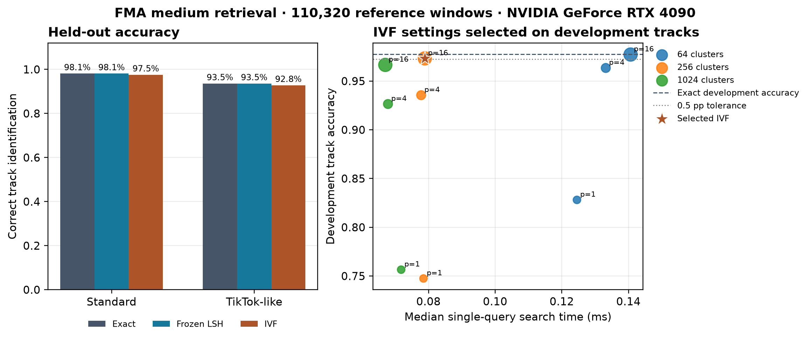

# Spherical IVF on the FMA medium fingerprints

## Result

This run evaluates a GPU inverted-file (IVF) index built with seeded spherical k-means over the 110,320 FMA medium reference windows. The split is track-disjoint: 2,542 development queries select the search budget, then 16,450 held-out queries compare the selected IVF with exhaustive cosine search and the frozen random-hyperplane LSH baseline. No held-out data was used to select the index settings.

On development tracks, the chosen configuration was 256 centroids and 16 probes. Its track accuracy was 97.325%, within the predeclared 0.5 percentage-point tolerance of exact search (97.758%). It visited 6,851 reference windows on average, or 6.21% of the collection. This choice was the fastest tested IVF configuration meeting that development accuracy threshold.

| Held-out query set | Exact | Frozen LSH | IVF | IVF minus exact |
| --- | ---: | ---: | ---: | ---: |
| Standard (7,458 queries) | 98.083% | 98.083% | 97.533% | -0.550 pp |
| TikTok-like (8,992 queries) | 93.539% | 93.539% | 92.771% | -0.767 pp |

The figure shows the held-out comparison and the development-only IVF sweep.

## Speed and memory

All retrieval measurements used a warmed NVIDIA GeForce RTX 4090 with queries, references and indexes resident on the GPU. The paired single-query samples were synchronized and randomized by method. These timings exclude fingerprint loading, host-to-device transfer and index construction.

| Method | Single-query median | Single-query p95 | Batched throughput |
| --- | ---: | ---: | ---: |
| Exact cosine search | 0.178 ms | 0.207 ms | 359,691 queries/s |
| Frozen LSH (64 tables, 3 extra probes) | 0.088 ms | 0.115 ms | 67,187 queries/s |
| IVF (256 centroids, 16 probes) | 0.076 ms | 0.163 ms | 448,621 queries/s |

The IVF lookup was 2.34× faster than exhaustive search at the median and 1.16× faster than accuracy-first LSH. LSH retained higher identification accuracy and a lower p95 latency. The GPU implementation selects up to 16 of 1,024 centroids with a single warp, then scans the selected lists in parallel. Input validation and index construction are performed before timed queries.

| Persistent device state | Size |
| --- | ---: |
| IVF index (centroids, list offsets and reference ordering) | 704,452 bytes |
| Frozen LSH index state | 29,159,680 bytes |
| Shared reference vectors | 112,967,680 bytes |

The IVF index state is about 41.4× smaller than the LSH state. Both methods still use the shared reference vectors. IVF fitting also used a 32 MiB temporary similarity buffer at the largest tested centroid count; the build took 0.076 seconds for the selected 256-centroid configuration (20 Lloyd iterations).

## Reproduction and limits

Run `notebooks/ivf_medium.ipynb` from the repository root after setting `AFP_FINGERPRINT_DIR` and retrieving the pinned LSH baseline files as described in its first cell. The notebook uses `notebooks/requirements-ivf.txt` in an isolated `uv` environment and writes the machine-readable measurements to `reports/ivf-medium.json` plus PNG and PDF figures under `reports/figures/`.

The spherical Lloyd initialization is seeded, but FP32 scatter-add accumulation can vary slightly with execution order. Small numerical and timing differences across runs are expected. The benchmark uses synthetic distortions and GPU-resident inputs, so its results do not represent every phone recording or end-to-end upload latency. The JSON records the input archive hashes, split seeds, baseline configuration, device and detailed distortion results.
