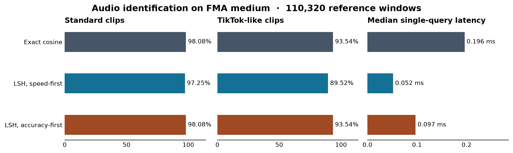

## Finding a song with locality-sensitive hashing

Our exact search identifies a song by comparing a query fingerprint with all 110,320 reference windows in FMA medium and returning the track with the highest cosine similarity. We used angular locality-sensitive hashing (LSH) to narrow that search. Each hash bit records which side of a random hyperplane a fingerprint falls on. Fingerprints pointing in similar directions tend to share bits. We look up the query’s bucket in each table, probe nearby buckets to recover candidates across a hash boundary, and rank the resulting windows by the same cosine score as exact search.

We picked **10 bits per table, 64 tables and three extra probes per table** because identification under distortion mattered more to us than the lowest possible latency. Our initial speed criterion selected 14 bits and 32 tables, also with three extra probes. That setting identified 89.52% of the TikTok-like queries, four percentage points below exact search. We then added an exploratory comparison using the setting with the highest accuracy on the standard development tracks. Its shorter hashes and larger number of tables gave distorted clips more chances to retrieve the correct song. It recovered 361 additional correct identifications on the 8,992 held-out TikTok-like clips. It matched exact search’s accuracy on both those clips (93.54%) and the 7,458 held-out standard clips (98.08%).

On an RTX 4090, the accuracy-first setting reduced median lookup time from **0.2065 ms to 0.0970 ms**, a **2.13× speedup**. We timed both methods on the same 256 individual queries, alternating their order and synchronizing the GPU after each lookup. The fingerprints and index were already in GPU memory, so this measures the retrieval step of song identification.

*FMA medium retrieval results. The figure shows the exact-search median from the speed-first comparison (0.196 ms). The 2.13× speedup uses the exact-search median measured alongside accuracy-first LSH (0.2065 ms).* [Vector figure](figures/gpu-operating-points-medium.pdf) · [Benchmark notebook](../notebooks/gpu_retrieval.ipynb) · [Measurements](gpu-retrieval-medium.json)
